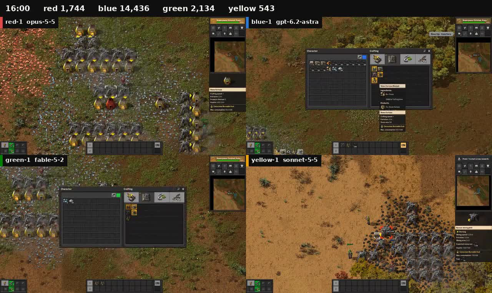
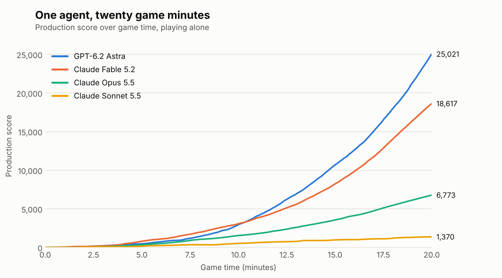
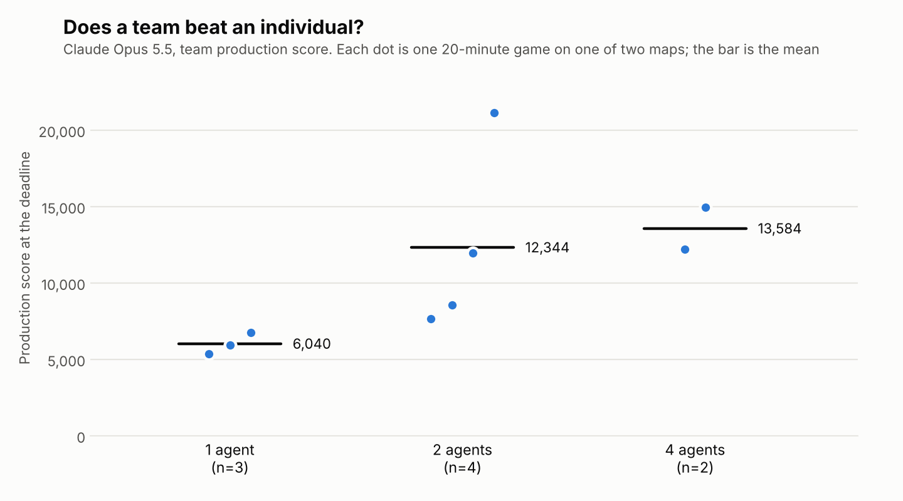
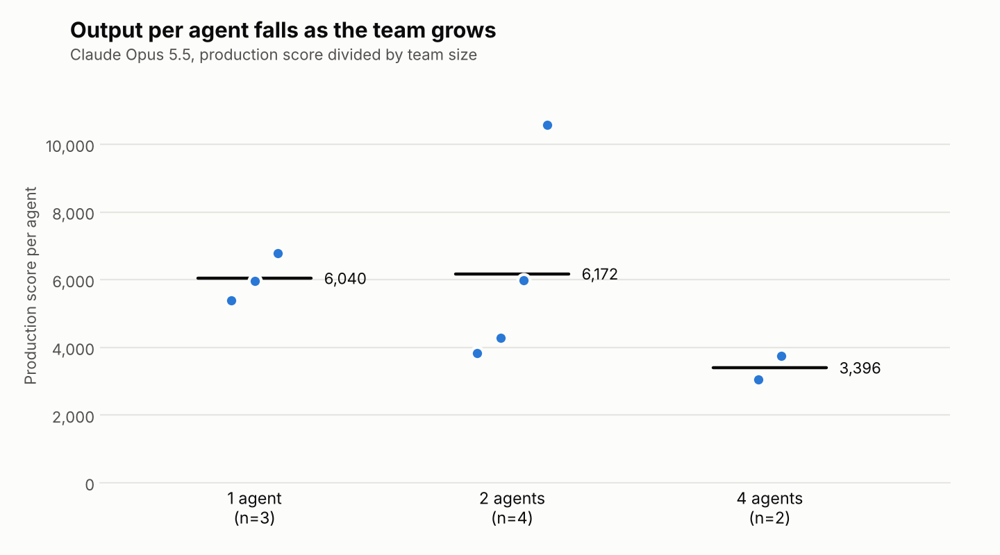
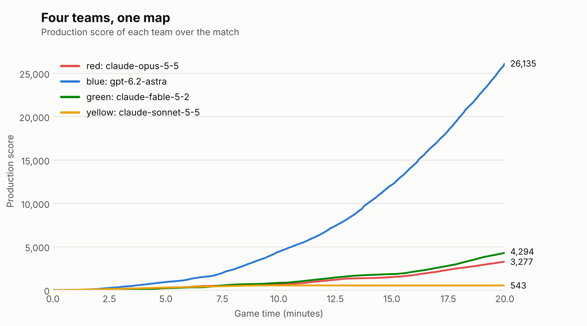
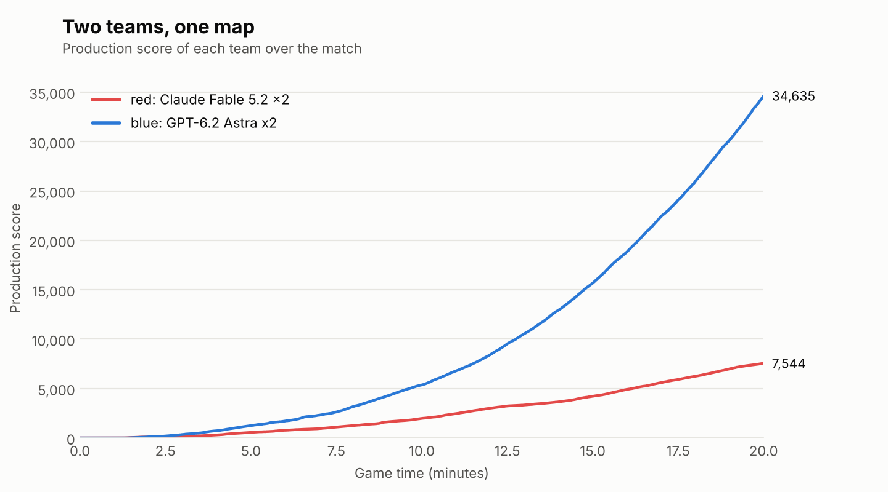
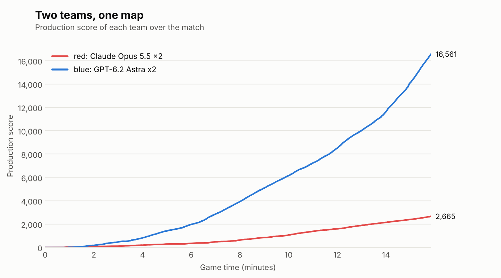
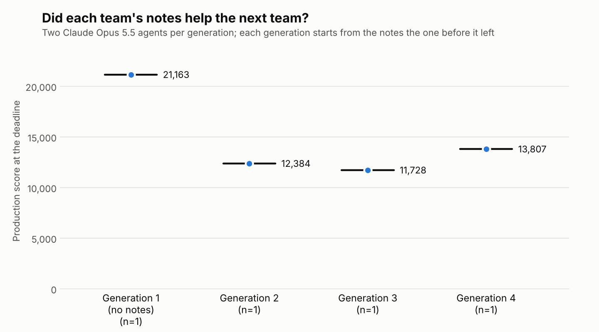
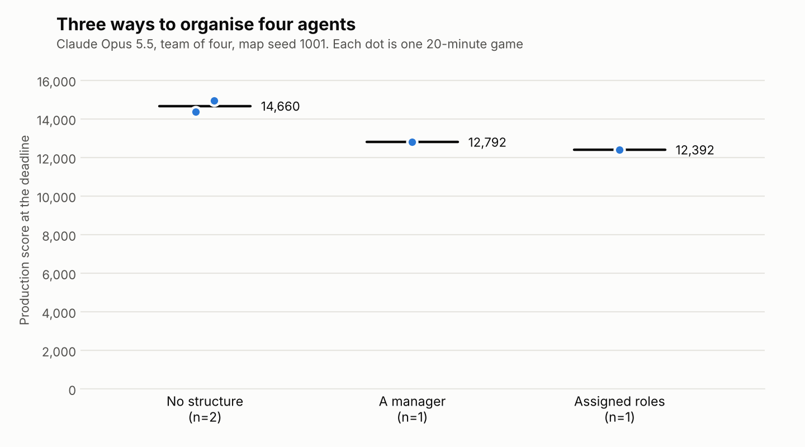

# Factorio bench

Language models play [Factorio](https://factorio.com) the way a person does: they see the screen and use the
mouse and keyboard. They play alone, in teams that share a factory, and against other teams on the same map. The
score is the game's own production score, read from the game server.

It exists to test one claim: that AIs can be put into rich simulated worlds where they have to cooperate and
compete with other AIs over long stretches, and that this can be measured. Factorio is a first, small example of
such a world.

> Work in progress from one night of runs (19 November 2026). Unofficial; not affiliated with Wube Software. You
> need your own copy of Factorio. Every number below comes from `results/night1/results.json`, built from the run
> files under `runs/` by `scripts/analyze_night.py`.



*Four models, one map, sixteen minutes in. Each panel is what that model sees. GPT-6.2 Astra (blue) has covered
the coal field with mining drills; Claude Sonnet 5.5 (yellow) is standing next to them.*

## What one night showed

- **It is possible, and cheap enough to iterate on.** 29 of 33 games ran the full 20 game minutes, 12,015 model turns in all, for $397.25. Building and testing the harness cost about $7 more. No GPU, no game modding beyond a scenario file of under 100 lines, and no model touched the game's console.
- **Models differ a lot at playing alone.** GPT-6.2 Astra scored 25,021, GPT-6.2 Sol 18,785, Claude Fable 5.2 18,617, Claude Opus 5.5 6,736 (mean of 4), Claude Sonnet 5.5 1,684 (mean of 2) and Claude Haiku 5.5 932.
- **Teams out-produce individuals, with sharply falling returns.** Two Claude Opus 5.5 agents averaged 1.8 times one agent's score; four averaged 2.1 times. Per agent, a team of four produced about half what an agent produces alone.
- **Competition for land changed the outcome.** With four models on one map, Astra scored 26,135, about what it scores alone, while Fable fell from 18,617 alone to 4,294 and Opus from 6,736 to 3,277. Astra covered the coal field with drills early and the others ran short of fuel. Two against two, GPT-6.2 Astra beat Claude Fable 5.2 34,635 to 7,544.
- **Written notes mostly did not help.** Models played alone starting from the notes Fable wrote after its own game: Opus 5.5 went from 6,736 to 7,833; Sonnet 5.5 went from 1,684 to 2,933; Haiku 5.5 went from 932 to 887; Fable 5.2 went from 18,617 to 16,618. Four generations of Opus teams passing notes down showed no upward trend either.
- **The measurements are noisy.** Identical two-agent games scored between 7,679 and 21,163. Most conditions here were played once, so treat single comparisons as leads, not findings.

Videos sit beside each game under `runs/`: the bases from above (`overview.mp4`) and, for most games with several agents, every agent's screen side by side (`screens.mp4`).

### One agent alone

Each model played the same 20-minute game alone on the same map. The gap is mostly in how much each one built. Astra placed 67 mining drills and 32 furnaces in 20 minutes; Opus placed 13 and 6. The two GPT models work in many small steps (over 500 turns each), while Fable got a similar score to Sol in about 150 turns by sending long batches of actions. Cost per game ran from $0.24 (Haiku) to $24.08 (Astra).



| Model | Score at 20 min | Games | Turns | Cost per game | Drills placed | Furnaces placed |
|---|---|---|---|---|---|---|
| GPT-6.2 Astra | 25,021 | 1 | 533 | $24.08 | 67 | 32 |
| GPT-6.2 Sol | 18,785 | 1 | 609 | $6.93 | 43 | 30 |
| Claude Fable 5.2 | 18,617 | 1 | 155 | $11.67 | 46 | 17 |
| Claude Opus 5.5 | 6,736 | 4 | 191 | $5.64 | 13 | 6 |
| Claude Sonnet 5.5 | 1,684 | 2 | 98 | $1.38 | 6 | 2 |
| Claude Haiku 5.5 | 932 | 1 | 194 | $0.24 | 3 | 6 |

### Does a team beat an individual?

The same model, Claude Opus 5.5, played alone, as a team of two and as a team of four, sharing one factory and one score, on two different maps. One agent averaged 6,736, two averaged 12,344 and four averaged 13,842. The second agent roughly doubled output; the third and fourth added little. Teams did organise themselves without being told to: in every team game the agents split the map by resource in the first minute and carried fuel and materials to each other. They sent 17 to 36 chat messages per game.





> I go NW to iron/copper, set up drills+furnaces. Suggest you mine coal (south) and bring some north.
> *agent-2, in-game chat, first minute of the highest-scoring two-agent game*

> OK, I take coal (south), will set up coal mining and bring coal north to you.
> *agent-1, replying*

> Coal is our bottleneck. Want me to bring drills to the coal field? ... Tip: chain coal drills facing each other so they self-fuel.
> *agent-2, later in the same game*

### Teams against each other

Four models were put on one map, each on its own team with its own buildings and score, sharing the same ore fields. Nothing stopped them interfering with each other except a cease-fire on weapons. Astra finished with 26,135, 6 times the next team. The Claude models scored far below what they score alone on the same map. Their own reasoning says why: Astra's drills occupied the coal field, coal is the fuel for everything else at this stage, and the others spent their time walking around someone else's machines. No team sent a message to another team in any game.



| Team | Models | Score | Turns | Cost |
|---|---|---|---|---|
| blue | GPT-6.2 Astra | 26,135 | 589 | $27.33 |
| green | Claude Fable 5.2 | 4,294 | 119 | $7.87 |
| red | Claude Opus 5.5 | 3,277 | 173 | $5.08 |
| yellow | Claude Sonnet 5.5 | 543 | 10 | $0.21 |

> I'm stuck among trees with coal down at the bottom left, guarded by someone's drill grid of ten drills.
> *Claude Opus 5.5 (red), reasoning summary at 8:04*

> I'm checking the coal patch: Blue's four drills already feed each other in a ring, and Yellow is hand-mining with 96 coal.
> *Claude Fable 5.2 (green), reasoning summary at 4:50*

> I doubt I can catch the blue score, but I'll still try to maximize mine.
> *Claude Fable 5.2 (green), at 4:07*

> The character barely moved, so I suspect blue's buildings are blocking the way.
> *Claude Opus 5.5 (red), reasoning summary at 10:36*

Claude Fable 5.2 against GPT-6.2 Astra, two agents each: Astra's pair finished on 34,635 and Fable's on 7,544. An earlier match, Claude Opus 5.5 against GPT-6.2 Astra, stood at 16,561 to 2,665 for Astra when it ended early at 15:50: an Opus agent clicked Quit in the game's menu, which at that point ended the game for everyone. The harness now puts such a player back in.



| Team | Models | Score | Turns | Cost |
|---|---|---|---|---|
| blue | GPT-6.2 Astra ×2 | 34,635 | 1060 | $48.32 |
| red | Claude Fable 5.2 ×2 | 7,544 | 267 | $16.47 |



| Team | Models | Score | Turns | Cost |
|---|---|---|---|---|
| blue | GPT-6.2 Astra ×2 | 16,561 | 702 | $30.86 |
| red | Claude Opus 5.5 ×2 | 2,665 | 300 | $8.11 |

### Notes from one team to the next

At the end of each game every agent was asked for the notes it would leave the next player. Two tests used them. In the first, four generations of two-agent Opus teams each started from the previous team's notes. Scores went 21,163, 12,384, 11,728, 13,807: no upward trend, and the first team, with no notes, happened to be the best. In the second, models played alone starting from the notes Fable wrote after its solo game. Only Sonnet did clearly better with them; Fable's notes are specific and correct, but most of what separates the models here seems to be execution through the screen, which notes do not transfer.



| Model given Fable's notes | Alone, no notes | With the notes |
|---|---|---|
| Claude Opus 5.5 | 6,736 | 7,833 |
| Claude Sonnet 5.5 | 1,684 | 2,933 |
| Claude Haiku 5.5 | 932 | 887 |
| Claude Fable 5.2 | 18,617 | 16,618 |

> Hand-crafting in the last 3 minutes roughly doubled my score rate ... Keep the hand-craft queue busy THE WHOLE GAME, not just at the end. That was my biggest miss.
> *From the notes Claude Fable 5.2 left after scoring 18,617*

> Never left-click an entity with an item in hand near menus, never press Escape; quitting ends the run.
> *Same notes*

### Three ways to organise four agents

Four Opus agents played the same game three ways: with no structure, with the first agent named as manager, and with four roles assigned in advance. Unstructured teams scored 14,960 and 14,360. The managed team scored 12,792. The manager did manage: it posted a plan at the start, sent each agent to a resource, and the others acknowledged and reported back, but the result was no better. The team with assigned roles scored 12,392. Both imposed structures came in a little below the unstructured teams, which had sorted themselves into much the same roles in the first minute anyway. One game per structure is not enough to rank them.



| Organisation of a team of four | Scores |
|---|---|
| No structure | 14,960, 14,360 |
| A manager | 12,792 |
| Assigned roles | 12,392 |

## How a game works

- **The models play the real game by hand.** Each agent has its own copy of Factorio 2.1 on its own virtual
  screen. It sees screenshots (1280x720) and acts with the mouse and keyboard: click, drag, type, hold a key, hold
  a mouse button, scroll, zoom in on part of the screen. Nothing reads the game's memory for it and there is no
  scripting interface. Claude models use Anthropic's computer-use toolset; GPT models get the same actions, with
  the same names and inputs, as function tools (`factoriobench/tools.py`).
- **The clock only runs while someone is acting.** The game is paused whenever any agent is thinking, so a slow
  API does not cost game time. Every agent acts at its own pace, as players do in a real multiplayer game: when
  the game runs, each agent's current actions run at once, and it pauses again as soon as one of them has finished
  and needs to look at its screen. An agent in the middle of a long action (holding a key to walk, say) is frozen
  through the pause and carries on afterwards.
- **The score is the game's own.** A game server holds the map and the agents join it as ordinary players. The
  harness reads the score from the server, which no agent can reach. The score is the production score from
  Factorio's own PvP mode: the value, at the game's built-in price list, of everything a team has produced and not
  used up. Two things differ from the game's formula. Science packs spent on research keep their value, so
  research is not scored as a loss. Wood and fish are worth nothing, because at the game's prices chopping trees
  would beat building a factory.
- **Cheating is closed off by the game.** Agents are not admins, so the game refuses console commands and the map
  editor and logs each attempt. Every run's summary records whether it was clean. Every run so far was.
- **One start, one deadline.** Every game is the game's standard freeplay on a fixed map seed, with the standard
  starting items, peaceful natives and permanent daylight (a night-time screenshot is close to black). Games run
  for 20 game minutes, which takes 35 to 110 minutes of real time.

A game takes one of three shapes:

| Shape | What it is | What it measures |
|---|---|---|
| Solo | One agent | How well one model plays |
| Team | Two or four agents of one model sharing a factory and a score, talking through the in-game chat | Whether a group out-produces an individual |
| Versus | Two to four teams on the same map, each with its own buildings, research and score, sharing the same ore | Who wins when models compete for the same land |

Two more switches exist for team games. `--org` sets how a team is organised: no structure, a manager, or roles
assigned in advance. `--handbook` starts a game from the notes an earlier team wrote; every agent is asked for
such notes when its game ends.

## What to distrust

- **Few games per condition.** Only Opus alone (4 games), Opus pairs (4) and Opus fours (3) were repeated. Every other number on this page is one game.
- **Twenty minutes is the early game.** Nobody got past burner drills and stone furnaces. At this horizon the score mostly rewards digging and hand-crafting, and Astra's winning play (self-fuelling coal drills, then crafting chests for points) would not be the best play in a longer game.
- **Spending differs between models.** Astra took about three times as many turns as Fable and cost twice as much per game. Everything ran at medium reasoning effort; nothing was tuned per model.
- **The machines were overloaded.** Five game clients shared four CPU cores with software rendering, at 5 to 8 frames a second. To save CPU the clients are briefly frozen while models think, which sometimes puts the game's "player is being dropped" warning on other players' screens.
- **The Quit button.** Agents quit the game by accident through the Escape menu seven times (Opus four times, Astra twice, Fable once). Three games ended early before the harness learned to put the player back in; they are listed under Every game and left out of the charts. A fourth game could not start because the game before it left no notes.
- **One model family per team.** No mixed-lab teams were tried, and the map was the same in all but three games.

## Running it

```sh
sudo apt-get update && sudo apt-get install -y xvfb xdotool ffmpeg
python -m venv .venv && . .venv/bin/activate    # Python 3.11+
pip install -e '.[dev]' matplotlib
python -m pytest                                 # no game and no API calls
```

The game has to be downloaded with a factorio.com account that owns it. `python -m factoriobench setup` does this
from `FACTORIO_USERNAME` and `FACTORIO_TOKEN`, but factorio.com currently refuses Python's default user agent; if
it fails, download `https://factorio.com/get-download/stable/alpha/linux64?username=...&token=...` with curl and
unpack it to `~/.factorio-bench/full`.

```sh
export ANTHROPIC_API_KEY=... OPENAI_API_KEY=...

# one agent
python -m factoriobench run --out runs/demo/solo --model claude-opus-5-5 --minutes 20

# a team of two sharing a factory, with a manager
python -m factoriobench run --out runs/demo/team --model claude-opus-5-5,claude-opus-5-5 --org manager

# two teams on one map
python -m factoriobench run --out runs/demo/match \
    --team red=claude-fable-5-2,claude-fable-5-2 --team blue=gpt-6.2-astra,gpt-6.2-astra

python -m factoriobench report runs/demo/match
python -m factoriobench timelapse runs/demo/match --screens    # every agent's screen, side by side
python -m factoriobench timelapse runs/demo/match --overview   # the bases from above
```

No GPU is needed: the clients render in software. Each client wants about 2 GB of memory and most of a core, so a
4-core, 16 GB machine holds five clients. `scripts/runq.py` runs a queue of games and makes a game wait until the
machine has room. `--max-usd` caps one game and `--budget` caps the total on the spend ledger.

A run directory holds `config.json`, `summary.json`, `milestones.json`, `log.jsonl` (every turn: what the model
said, its reasoning summary, its actions, cost, game time, and the score at every pause), the server's chat log,
each agent's `handbook.md`, and two videos. Screenshots, conversations and saves stay out of git.

## Repository map

| Path | What it holds |
|---|---|
| `factoriobench/run.py` | One game: the scheduler that lets every agent act at its own pace, teams, the deadline, reconnection, handbooks |
| `factoriobench/scenario/control.lua` | The game's freeplay plus teams: puts each joining player on its team's force |
| `factoriobench/server.py` | The game server: Lua over RCON, the pause switch, team setup, the price list, the console-log audit |
| `factoriobench/client.py`, `desktop.py`, `clock.py` | The virtual screen and game client, every mouse and keyboard action, and the clock that suspends them through a pause |
| `factoriobench/llm.py`, `tools.py` | Model conversations for Claude and GPT models, prices, context compaction, the shared action set |
| `factoriobench/scoring.py` | The production score and the milestone ladder |
| `factoriobench/prompts.py` | Everything a model is told (versioned) |
| `factoriobench/report.py`, `charts.py` | Reports, videos and charts |
| `scripts/` | The queue runner, live status, and the analysis that builds `results/` |
| `runs/night1`, `runs/w1`, `runs/w3`, `runs/w4` | The first night's games, from four machines |
| `results/night1` | Charts, videos and `results.json` |
| `prototype/`, `docs/HANDOFF.md` | The first single-file prototype and the brief the project started from |

## What I would do next

- **Repeat everything five times.** At $5 to $25 a game, a real leaderboard with error bars is a few hundred dollars.
- **Longer games on a GPU machine.** One to three game hours reaches electricity, research and automation, where organisation should matter far more than it does when everyone is digging by hand.
- **Real conflict.** The harness already has a switch that lets teams attack each other, and the game ships its own team modes. The interesting version is the one where what you produce hurts the other side.
- **More agents per team.** Four was the limit of one small machine, not of the design.
- **A rating.** With repeats, the matches give a single head-to-head rating per model, as in the Clocktower benchmark.
